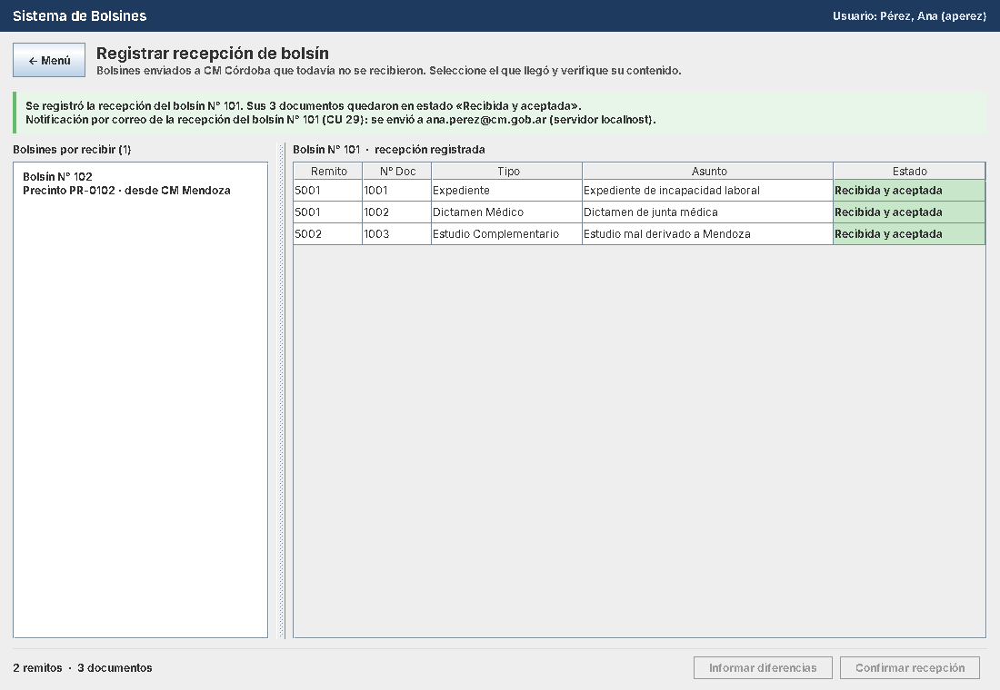

# Cómo ejecutar y probar el CU 28 (paso a paso)

Guía pensada para alguien que nunca usó Java ni la terminal. Si seguís los pasos en orden,
no hace falta instalar nada más que **Java**.

> **Versión corta** (si ya tenés Java 17+): descargá el proyecto, entrá a la carpeta que
> tiene el archivo `ejecutar.bat` y hacé **doble clic en `ejecutar.bat`**.
> En Mac/Linux: `./ejecutar.sh`.

---

## Qué se necesita

| Qué | ¿Hay que instalarlo? |
|-----|----------------------|
| **Java 17 o superior** | **Sí**, una sola vez (Paso 1) |
| Maven | No: el proyecto trae `mvnw.cmd`, que lo descarga solo |
| Base de datos | No: es SQLite, un archivo (`bolsines.db`) que se crea solo |
| Git | No: se puede bajar el proyecto como ZIP |
| Internet | Sólo **la primera vez** que se compila (descarga dependencias), y para enviar el correo |
| Cuenta de correo | Para que el correo de notificación se envíe de verdad (Paso 3b). Si no se configura, el programa funciona igual y guarda el correo como archivo |

> ⚠️ **Para el día de la defensa:** compilen al menos una vez **antes** en la PC que van a
> usar, con Internet. Después funciona sin conexión.

---

## Paso 1 — Instalar Java (una sola vez)

### Windows

1. Abrí **PowerShell**: tecla Windows → escribí `powershell` → Enter.
2. Pegá este comando y apretá Enter:
   ```powershell
   winget install Microsoft.OpenJDK.21
   ```
   - Si pregunta `Do you agree to all the source agreements terms? [Y] Yes [N] No`, escribí
     `y` y Enter.
   - Si Windows pide permiso de administrador, aceptá.
   - Tiene que terminar con `Successfully installed`.
3. **Cerrá PowerShell y abrí uno nuevo.** Si no lo hacés, el comando `java` no se reconoce.
4. Verificá:
   ```powershell
   java -version
   ```
   Tiene que mostrar algo como `openjdk version "21.0.x"`.

Si `winget` no existe en tu PC, descargá el instalador `.msi` de Java 21 desde
<https://learn.microsoft.com/java/openjdk/download> (o <https://adoptium.net>), instalalo
con "Siguiente, Siguiente…" y seguí desde el punto 3.

### Mac

```bash
brew install openjdk@21
```
(o descargá el instalador desde <https://adoptium.net>). Verificá con `java -version`.

### Linux (Ubuntu/Debian)

```bash
sudo apt install openjdk-21-jdk
```

---

## Paso 2 — Descargar el proyecto

### Opción A: como ZIP (no necesita Git)

1. Entrá a <https://github.com/StefaNovaliere/DSI-PPAI>.
2. Botón verde **`<> Code`** → **Download ZIP**.
3. Descomprimí el ZIP (clic derecho → **Extraer todo…**), por ejemplo en `Documentos`.
4. **Ojo con la carpeta duplicada:** Windows suele crear una carpeta dentro de otra con el
   mismo nombre:
   ```
   Documentos\DSI-PPAI-claude-nice-ramanujan-nzbzys\          ← ésta NO
   Documentos\DSI-PPAI-claude-nice-ramanujan-nzbzys\DSI-PPAI-claude-nice-ramanujan-nzbzys\   ← ésta SÍ
   ```
   La carpeta correcta es la que tiene adentro `ejecutar.bat`, `mvnw.cmd`, `pom.xml` y `src`.

### Opción B: con Git

```powershell
cd $HOME\Documents
git clone https://github.com/StefaNovaliere/DSI-PPAI.git
cd DSI-PPAI
```
(Si `git` no se reconoce: `winget install Git.Git`, cerrar y reabrir PowerShell.)

---

## Paso 3 — Ejecutar

### Forma fácil (Windows): doble clic

En la carpeta correcta del Paso 2, hacé **doble clic en `ejecutar.bat`**.

- Se abre una ventana negra que dice `Compilando el proyecto...`. **La primera vez tarda
  unos minutos** (descarga Maven, Hibernate y el driver de SQLite). Las siguientes veces,
  unos segundos.
- Después se abre la ventana **"Sistema de Bolsines"**. No cierres la ventana negra mientras
  usás la aplicación.
- Si Windows muestra *"Windows protegió su PC"*: **Más información → Ejecutar de todas
  formas** (pasa con cualquier archivo `.bat` descargado de Internet).

Para **volver los datos al estado inicial** (por ejemplo, antes de la defensa, o para repetir
la prueba) hacé doble clic en **`ejecutar-desde-cero.bat`**.

### Forma manual (PowerShell)

1. Abrí PowerShell **en la carpeta del proyecto**. La forma más fácil: en el Explorador de
   archivos, entrá a la carpeta correcta, hacé clic en la barra de direcciones, escribí
   `powershell` y Enter.
2. Compilá (tiene que terminar con `BUILD SUCCESS`):
   ```powershell
   .\mvnw.cmd package
   ```
   Esto además corre las 16 pruebas automáticas.
3. Ejecutá:
   ```powershell
   java -jar target\ppai-bolsines-g10-1.0.0.jar
   ```
   Variantes:
   ```powershell
   java -jar target\ppai-bolsines-g10-1.0.0.jar --reiniciar-datos   # vuelve a los datos de prueba
   java -jar target\ppai-bolsines-g10-1.0.0.jar --consola           # versión por consola, sin ventana
   ```

### Mac / Linux

```bash
./ejecutar.sh                    # o: ./ejecutar.sh --reiniciar-datos
```

### Desde IntelliJ IDEA (alternativa)

1. **File → Open…** → elegir la carpeta del proyecto (la que tiene `pom.xml`) → *Open as
   Project*. IntelliJ reconoce el proyecto Maven y descarga las dependencias solo.
2. Abrir `src/main/java/ppai/App.java` y apretar el ▶ verde al lado de `main`.
3. Para reiniciar los datos: **Run → Edit Configurations… → Program arguments:**
   `--reiniciar-datos`.

---

## Paso 3b — Configurar el envío de correo

Al registrar una recepción, el sistema envía un correo de notificación (CU 29). Para que se
envíe de verdad hay que decirle qué servidor de correo usar. **Sin este paso el programa
funciona igual**, pero guarda el correo como archivo en la carpeta `correos-simulados`.

1. En la carpeta del proyecto, copiá `correo.properties.ejemplo` con el nombre
   **`correo.properties`**.
   > ⚠️ En Windows, si lo creás con el Bloc de notas, fijate que no quede
   > `correo.properties.txt`: en "Guardar como" elegí *Tipo: Todos los archivos*.
2. Abrilo y completá **una** de las dos opciones.

### Opción A: Gmail (el correo llega a una casilla real)

Gmail no deja usar la contraseña normal: hace falta una **contraseña de aplicación**.

1. Activá la **verificación en dos pasos** de la cuenta: <https://myaccount.google.com/security>.
2. Entrá a <https://myaccount.google.com/apppasswords>, escribí un nombre (por ejemplo
   "PPAI Bolsines") y tocá **Crear**.
3. Copiá la contraseña de 16 letras que aparece. Va en `correo.contrasenia`, con o sin
   espacios.
4. Completá en `correo.properties`:
   ```properties
   correo.smtp.host=smtp.gmail.com
   correo.smtp.puerto=587
   correo.smtp.starttls=true
   correo.smtp.ssl=false
   correo.usuario=tu.cuenta@gmail.com
   correo.contrasenia=abcd efgh ijkl mnop
   correo.remitente=tu.cuenta@gmail.com
   correo.redirigirA=tu.cuenta@gmail.com
   ```

Las cuentas de la facultad o de una empresa a veces no permiten contraseñas de aplicación:
en ese caso usá una cuenta de Gmail personal.

### Opción B: Mailtrap (bandeja de prueba, no le llega a nadie)

1. Creá una cuenta gratis en <https://mailtrap.io>.
2. Entrá a **Email Testing → Inboxes → My Inbox → SMTP** y copiá host, puerto, usuario y
   contraseña.
3. Completá la "Opción B" del archivo de ejemplo. Los correos se ven en la página de Mailtrap.

### `correo.redirigirA`: para la demo

Los empleados de prueba tienen correos ficticios (`ana.perez@cmcordoba.example`). Con
`correo.redirigirA=tu.cuenta@gmail.com`, **todos los correos te llegan a vos**, y el correo
aclara a quién iba dirigido. Dejalo vacío solo si los empleados tienen correos reales.

### Comprobar que quedó bien

Abrí el programa. Debajo de la opción del menú tiene que decir:
*"Notificaciones por correo: se envían por SMTP (smtp.gmail.com:587)…"*. Si dice "no se
envían porque…", el motivo indica qué falta.

> ⚠️ **Para la defensa:** probalo antes **en la red de la facultad**. Algunas redes bloquean
> el puerto 587. Si pasa, probá `correo.smtp.puerto=465`, `correo.smtp.ssl=true` y
> `correo.smtp.starttls=false`, o usá los datos del celular.

---

## Paso 4 — Probar el caso de uso (guion)

Datos de prueba: el usuario logueado es **Ana Pérez (`aperez`) de CM Córdoba**. Hay dos
bolsines enviados a CM Córdoba pendientes de recepción: **101** (desde CM Rosario) y **102**
(desde CM Mendoza). Los bolsines 103 (va a otra CM) y 104 (ya recibido) no deben aparecer.

> Empezá con `ejecutar-desde-cero.bat` para que los datos estén en su estado inicial.

### Flujo principal

1. En el menú, elegí **Registrar recepción de bolsín**.
   → A la izquierda aparecen los bolsines por recibir: **101** y **102**.
2. Hacé clic en el **101**.
   → A la derecha aparece su contenido: 2 remitos con 3 documentos, dos **En bolsín
   enviado** (celeste) y uno **Para redirigir** (naranja).
3. Apretá **Confirmar recepción** y, en el diálogo, **Registrar recepción**.
   → Arriba aparece un aviso verde: *"Se registró la recepción del bolsín N° 101. Sus 3
   documentos quedaron en estado «Recibida y aceptada»"*. Debajo dice *"Enviando la
   notificación por correo…"*, y en unos segundos cambia a *"…se envió a …"*. Los 3
   documentos quedan en verde y el 101 desaparece de la lista.
4. Revisá la casilla de `correo.redirigirA` (o Mailtrap): llega el correo *"Recepción
   registrada del bolsín N° 101 (precinto PR-0101)"* con la tabla de documentación. Si no
   configuraste el correo, el aviso indica en qué archivo de `correos-simulados` quedó
   guardado.



### Flujos alternativos

| Flujo | Cómo probarlo | Resultado esperado |
|-------|---------------|--------------------|
| **A2 – No confirmar** | Clic en el **102** → **Confirmar recepción** → **Volver** | Aviso: *"No se registró la recepción del bolsín N° 102: la operación fue cancelada"*. Los estados no cambian y el 102 sigue en la lista. |
| **A3 – Hay diferencias** | Clic en el **102** → **Informar diferencias** | Aviso: la recepción no se registra y corresponde el CU 31. Nada cambia. |
| **A1 – No hay bolsines** | Recibir el 101 y el 102 (flujo principal) | Aviso *"No hay bolsines enviados pendientes de recepción"* y la lista queda vacía. |
| **A5 – Falla el correo** | Poner una contraseña incorrecta en `correo.properties`, abrir el programa y recibir un bolsín | Aviso *"No se pudo enviar la notificación por correo… rechazó el usuario o la contraseña. La recepción quedó registrada igual."* |

### Verificar que se guardó en la base de datos

1. Cerrá la aplicación y volvé a abrirla con **`ejecutar.bat`** (no el "desde cero").
2. Menú → Registrar recepción de bolsín → el **101 ya no aparece**: la recepción quedó
   guardada en `bolsines.db`.

### Dónde está el patrón State

El patrón no se ve en la pantalla: es una decisión de diseño interno. Se refleja en que el
bolsín 101 trae documentación en **dos estados distintos** y las dos se reciben
correctamente con la misma operación `recibir()`, cada una resuelta por su propio objeto
estado. En el código, ver `Documentacion.recibir()`, `EnBolsinEnviado.recibir()` y
`ParaRedirigir.recibir()`; y en las pruebas, `EstadoDocumentacionTest`.

El detalle del diseño y de dónde interviene el patrón está en el [README](README.md#7-patrón-state).

---

## Actualizar a una versión nueva

- **Si lo bajaste como ZIP:** borrá la carpeta anterior y extraé el ZIP nuevo. **No lo
  extraigas encima**, porque quedan archivos viejos que ya no compilan. En PowerShell:
  ```powershell
  cd $HOME\Documents
  Remove-Item -Recurse -Force .\DSI-PPAI-claude-nice-ramanujan-nzbzys
  Expand-Archive "$HOME\Downloads\DSI-PPAI-claude-nice-ramanujan-nzbzys.zip" -DestinationPath $HOME\Documents
  ```
  (Si en Descargas hay varios ZIP con el mismo nombre, el más nuevo puede terminar en `(1).zip`.)
- **Si lo clonaste con Git:** `git pull`.

Después, volver a ejecutar con `ejecutar-desde-cero.bat`.

---

## Problemas frecuentes

| Mensaje / síntoma | Causa | Solución |
|-------------------|-------|----------|
| `java : El término 'java' no se reconoce…` | Java no está instalado, o la terminal se abrió antes de instalarlo | Paso 1. Después **cerrar y reabrir** PowerShell |
| `ejecutar.bat` muestra "No se encontró Java" | Ídem | Ídem; si recién instalaste Java, cerrá la ventana y volvé a hacer doble clic |
| `.\mvnw.cmd : El término… no se reconoce` | Estás en la carpeta equivocada (la de afuera del ZIP) | Entrá a la carpeta que contiene `mvnw.cmd` (Paso 2, "carpeta duplicada"). Con `dir` ves qué hay |
| `git : El término 'git' no se reconoce…` | Git no está instalado | Usá la Opción A (ZIP) o `winget install Git.Git` |
| `Unable to access jarfile target\ppai-bolsines-g10-1.0.0.jar` | No se compiló, o la compilación falló | Correr `.\mvnw.cmd package` y esperar `BUILD SUCCESS` |
| La compilación falla con errores de descarga / `Could not resolve` | Sin Internet (la primera vez es necesaria) | Conectarse a Internet y volver a compilar |
| Errores de compilación en archivos que no existen en GitHub (por ejemplo `DemostracionPatronState.java`) | Se descomprimió una versión nueva **encima** de la anterior: Windows no borra los archivos que se eliminaron | Borrar la carpeta del proyecto y extraer el ZIP nuevo en una carpeta limpia (ver "Actualizar a una versión nueva") |
| `UnsupportedClassVersionError` | La versión de Java es menor a 17 | Instalar Java 21 (Paso 1) |
| La lista de bolsines aparece vacía | Ya se recibieron el 101 y el 102 (los cambios quedan guardados) | Usar `ejecutar-desde-cero.bat` o `--reiniciar-datos` |
| "Windows protegió su PC" al abrir el `.bat` | Protección de Windows para archivos descargados | **Más información → Ejecutar de todas formas** |
| *"No se pudo enviar la notificación… rechazó el usuario o la contraseña"* | Gmail no acepta la contraseña normal | Usar una **contraseña de aplicación** (Paso 3b, Opción A) |
| *"No se pudo enviar la notificación… no se pudo conectar con smtp.gmail.com:587"* | La red bloquea el puerto, o no hay Internet | Probar puerto 465 con `correo.smtp.ssl=true` y `correo.smtp.starttls=false`, o usar los datos del celular |
| El menú dice *"no se envían porque no hay un servidor de correo configurado"* | No está `correo.properties` en la carpeta del proyecto, o se llama `correo.properties.txt` | Revisar el nombre exacto y que esté junto a `ejecutar.bat` (Paso 3b) |
| El correo dice que se envió pero no llega | Fue a la casilla ficticia del empleado | Completar `correo.redirigirA` con tu casilla; revisar también Spam |
| En la versión por consola los acentos se ven como `?` | Codificación de la consola de Windows | Ejecutar `chcp 65001` antes, o usar la ventana gráfica |
