# PPAI 2026 – 3K2 – Grupo 10 – Entrega 2: CU 28 "Registrar Recepción de Bolsín"

Rediseño e implementación de la realización del caso de uso de análisis
`PPAI2026_3K2_G10_E1_Analisis`, aplicando el **patrón de diseño State (Gamma)** a las clases
con estado del CU (`Documentacion`, `Bolsin` y `Remito`), bajo el **Paradigma Orientado a
Objetos**.

> ### ▶ ¿Querés ejecutarlo? Seguí la guía paso a paso: **[COMO_EJECUTAR.md](COMO_EJECUTAR.md)**
> Resumen: instalar Java 17+, descargar el proyecto y hacer doble clic en **`ejecutar.bat`**.
> La guía incluye un guion para probar el flujo principal y los alternativos, y una tabla de
> problemas frecuentes.

**Diseño (Entrega 2):** [`docs/PPAI2026_3K2_G10_E2_Diseño.pdf`](docs/PPAI2026_3K2_G10_E2_Dise%C3%B1o.pdf) tiene la carátula,
la identificación del patrón, los detalles de implementación, el diagrama de clases (el
rediseño del grupo) y el diagrama de secuencia. Los dos diagramas están en
[`docs/CU28_diagramas.drawio`](docs/CU28_diagramas.drawio), para verlos y editarlos en
diagrams.net (draw.io). El diagrama de clases también está como imagen en
[`diagrama-clases/rediseno_grupo_con_metodos.png`](docs/diagrama-clases/rediseno_grupo_con_metodos.png),
y el de secuencia tiene su fuente PlantUML en
[`diagrama-secuencia/cu28_state_corregido.puml`](docs/diagrama-secuencia/cu28_state_corregido.puml).

## 1. Detalles de implementación

| Ítem | Elección |
|------|----------|
| a. Lenguaje | **Java 17** |
| b. Framework de programación | **Maven** (build y dependencias) · **JUnit 5** (pruebas). La interfaz gráfica usa **Swing** (incluido en Java). |
| c. Tecnología | **Escritorio** (aplicación Swing). También se puede ejecutar por consola. |
| d. Base de datos y persistencia | **SQLite** (archivo `bolsines.db`, no requiere instalar nada) con **JPA (Jakarta Persistence) implementado por Hibernate 6** como framework de persistencia |
| Envío de correo (CU 29) | **SMTP** con **Jakarta Mail** (implementación Eclipse Angus). Se configura en `correo.properties` (Gmail, Mailtrap u otro servidor). Sin configuración, los correos se guardan como archivos. Ver [sección 11](#11-envío-de-correo-cu-29) |

## 2. Cómo ejecutarlo

Ver **[COMO_EJECUTAR.md](COMO_EJECUTAR.md)** (instalación de Java, descarga, ejecución,
guion de prueba y problemas frecuentes). Resumen para quien ya tiene Java 17+:

| Sistema | Ejecutar | Volver a los datos de prueba |
|---------|----------|------------------------------|
| Windows | doble clic en `ejecutar.bat` | doble clic en `ejecutar-desde-cero.bat` |
| Mac / Linux | `./ejecutar.sh` | `./ejecutar.sh --reiniciar-datos` |
| Manual | `.\mvnw.cmd package` y `java -jar target\ppai-bolsines-g10-1.0.0.jar` | agregar `--reiniciar-datos` |

No hace falta instalar Maven (el proyecto trae el Maven Wrapper) ni una base de datos
(SQLite es el archivo `bolsines.db`, que se crea solo). **Los cambios quedan guardados**
entre ejecuciones.

Datos de prueba: el usuario logueado es `aperez` (Ana Pérez), de la **Comisión Médica
Central (CMC)**. Hay tres bolsines enviados a la CMC por recibir: 101 (desde CM Rosario), 102
(desde CM Mendoza) y 105 (desde CM Córdoba, con dos remitos). El 103 va a otra CM y el 104 ya
se recibió: esos dos **no** deben aparecer en la lista. El bolsín 101 trae una documentación en
estado `ParaRedirigir`, que también se recibe (otro estado concreto, el mismo evento
`recibir()`).

> **Si ya lo habían ejecutado antes:** la base de datos cambió. El programa detecta la base de
> la versión anterior y la vuelve a crear sola con los datos de prueba (avisa en la ventana
> negra). Si algo no se ve bien, usen `ejecutar-desde-cero.bat`.

## 3. Flujos del caso de uso implementados

Se implementa el **CU 28** completo según la ERS v1.2 (flujo principal y los seis flujos
alternativos), incluido el **envío real del correo** que hace el CU 29 (caso de uso incluido).

**Flujo principal:** el empleado elige "Registrar recepción de bolsín" en el menú. El
sistema muestra la CM del usuario y los bolsines enviados a ella que todavía no se
recibieron (CM origen y precinto), y permite elegir uno de la lista **o filtrar por número de
precinto o CM origen**. El empleado selecciona el bolsín y el sistema muestra cada remito con
su documentación (asunto y tipo). El sistema muestra las **cuatro opciones de recepción**; el
empleado elige la primera, "El contenido del bolsín es igual al registrado", y confirma. El
sistema:

1. registra el bolsín como *Recibido en CM destino* (patrón State en `Bolsin`);
2. registra los remitos como *Recibido y aceptado* (patrón State en `Remito`);
3. pasa cada documentación a *Recibida y aceptada* (patrón State en `Documentacion`), con el
   empleado responsable;
4. guarda todo en la base en una transacción;
5. llama al CU 29, que le envía a la **CM origen** un correo con la situación de cada remito y
   documento (SMTP, en segundo plano), y finaliza.

**Flujos alternativos (los de la ERS):**

| # | Situación | Qué hace el sistema |
|---|-----------|---------------------|
| A1 | No hay bolsín con el número de precinto ingresado en el filtro | Lo informa y vuelve a mostrar todos los bolsines |
| A2 | No hay bolsín con la CM origen ingresada en el filtro | Lo informa y vuelve a mostrar todos los bolsines |
| A3 | Opción 2: no se recibe toda la documentación | El empleado marca la que no llegó: queda *No recibida*, y su remito *Recibido y aceptado parcial*. El resto se recibe y acepta |
| A4 | Opción 3: hay documentación que no corresponde a la CM destino | La marcada queda *Recibida y rechazada* y su remito, *Recibido y aceptado parcial* |
| A5 | Opción 4: la documentación se debe redirigir a otra área | Sólo si la CM destino es la CMC. La marcada queda *Para redirigir*; el remito, *Recibido y aceptado* |
| A6 | El empleado no confirma ("Volver" en la confirmación) | No se registra nada y vuelve a las opciones de recepción, con lo que había marcado |

**Otras situaciones que el sistema controla:**

| Situación | Qué hace el sistema |
|-----------|---------------------|
| No hay bolsines enviados pendientes para la CM del usuario | Lo informa y finaliza (se ve después de recibir los tres) |
| Se marca documentación en un estado que no admite esa transición (por ejemplo, la 1003, *Para redirigir*, como "no llegó") | El objeto estado la rechaza, se deshace la transacción (rollback) y no se guarda ningún cambio |
| Falla el envío del correo (sin red, servidor caído, contraseña incorrecta) | Informa el motivo. La recepción ya quedó registrada: la notificación no la deshace |
| El empleado cancela (Observación 1) | En la ventana, "← Menú"; en la consola, la opción 0 |

## 4. Capturas

| Menú principal | Bolsines por recibir |
|---|---|
| 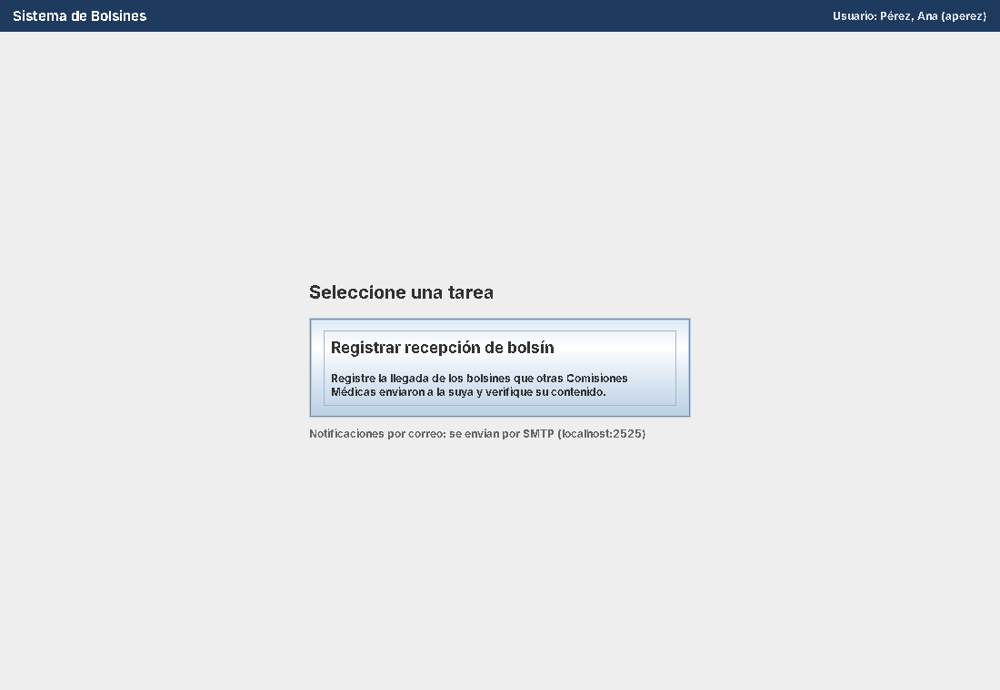 | 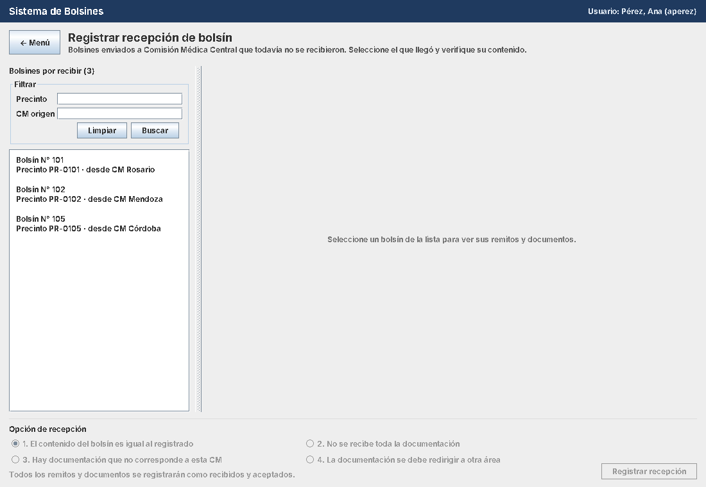 |
| **Filtro por CM origen** | **A1: filtro sin resultados** |
| 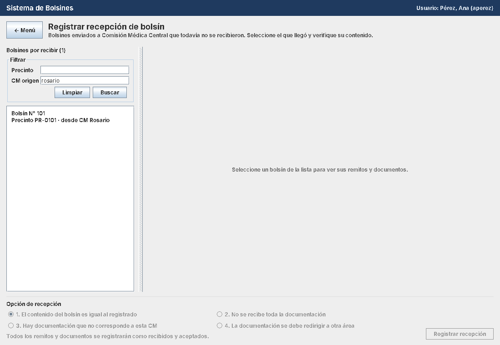 | 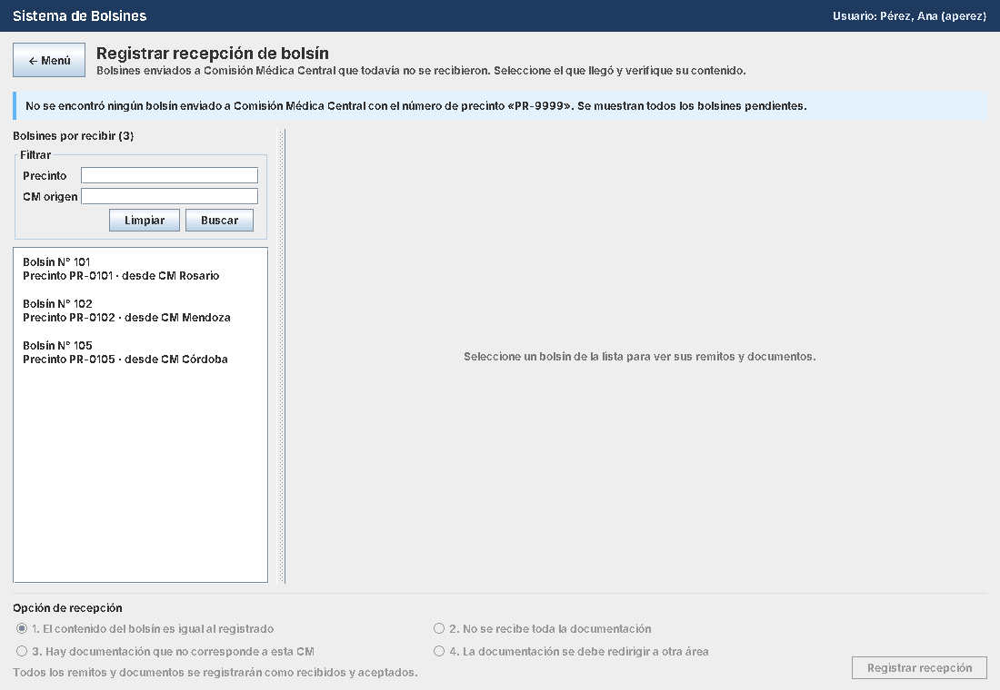 |
| **Contenido del bolsín y opciones de recepción** | **A3: se marca la documentación que no llegó** |
| 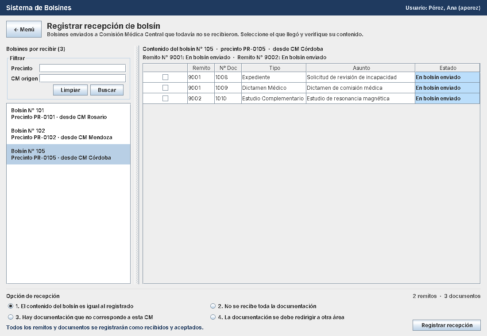 | 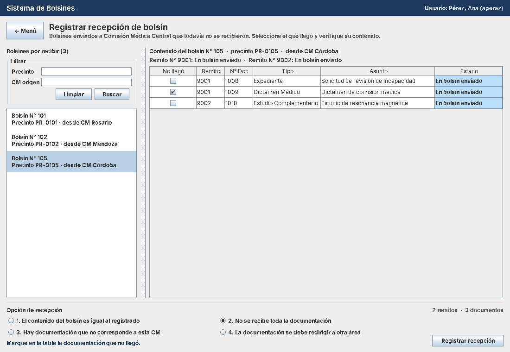 |
| **Confirmación con resumen** | **Recepción registrada: remito parcial** |
| 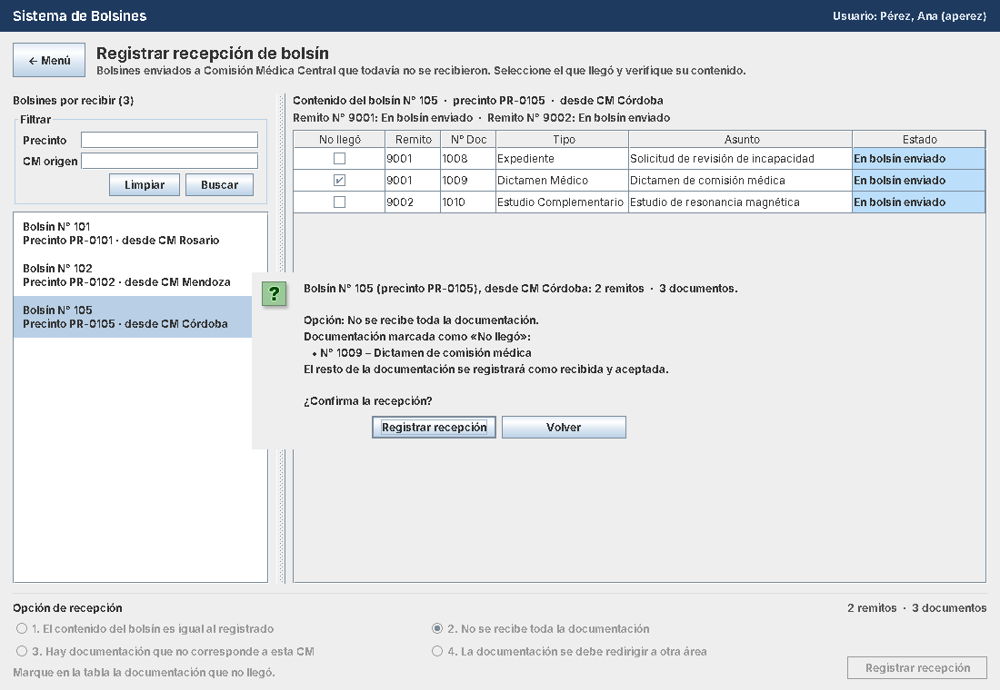 | 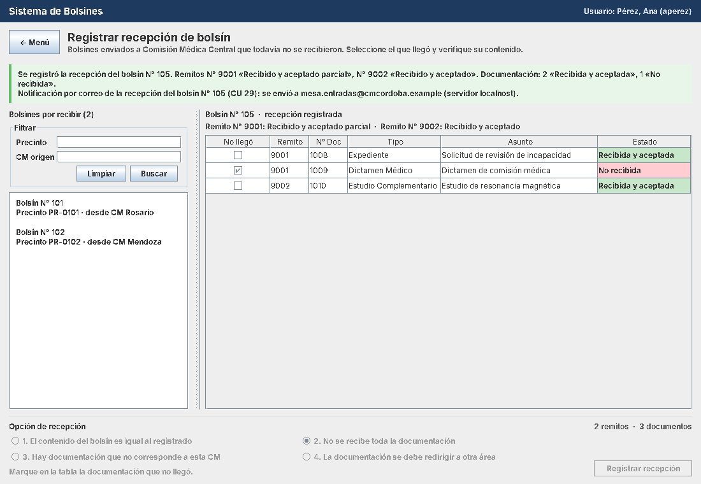 |
| **A5: documentación para redirigir** | **El estado rechaza una transición que no existe** |
| 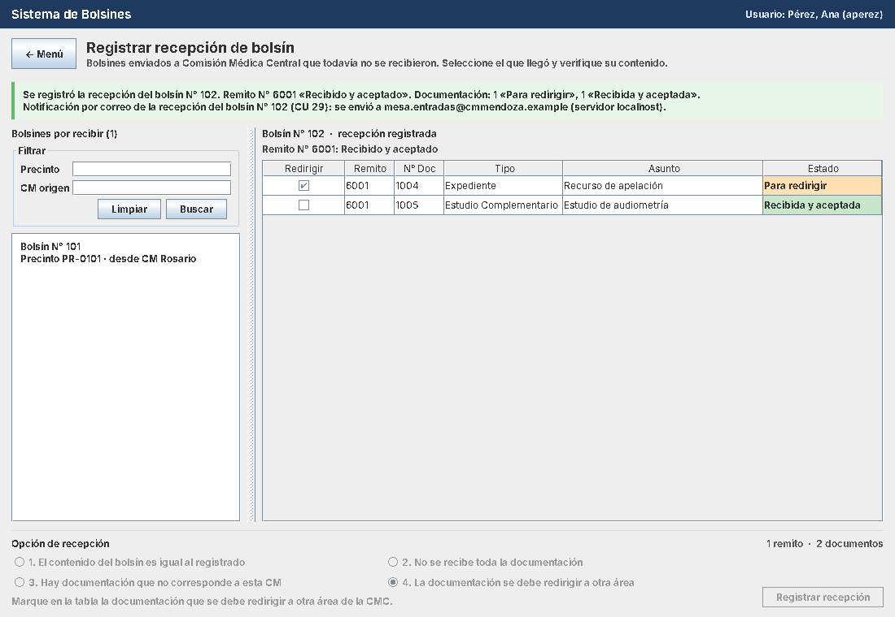 | 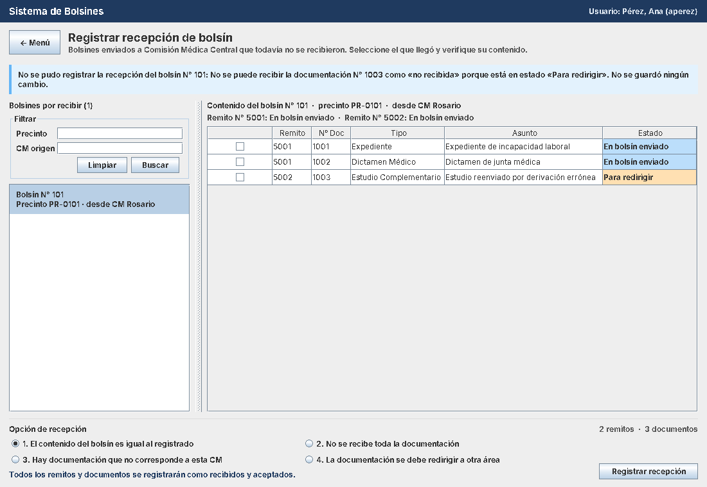 |
| **A6: el empleado no confirma** | |
| 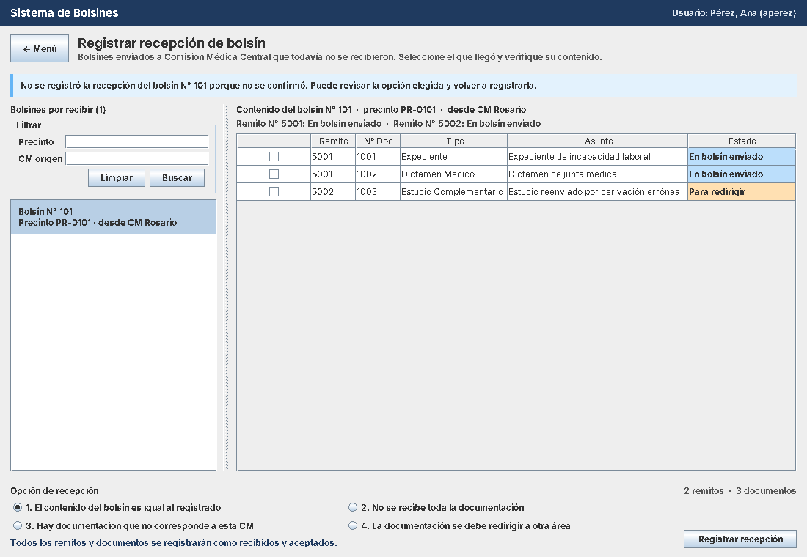 | |

## 5. Arquitectura (capas)

| Capa | Paquete | Clases |
|------|---------|--------|
| Interfaz (boundary) | `ppai.boundary` | `PantallaRecepcionBolsin` (interfaz), `PantallaGraficaRecepcionBolsin` (Swing), `PantallaConsolaRecepcionBolsin`, `PantallaPrincipal` (menú) |
| Control | `ppai.control` | `GestorRecepcionBolsin`, `GestorNotificacionCU29` (CU incluido: arma y envía el correo) |
| Dominio (entity) | `ppai.entidades` | `Bolsin`, `Remito`, `DetalleRemito`, `Documentacion`, `CambioEstadoBolsin`, `CambioEstadoDocumentacion`, `Empleado`, `Usuario`, `Sesion`, `ComisionMedica`, `TipoDocumento`, `OpcionRecepcion` (las 4 opciones del paso 7), `SituacionDocumentacion` (guarda de `recibir()`), `Estado` (clase abstracta general de los estados: nombre y descripción) |
| Patrón State | `ppai.entidades` | `Estado`: la clase abstracta de todos los estados (con ámbito) |
| Patrón State | `ppai.entidades.estadodocumentacion` | Los 9 estados concretos de Documentación |
| Patrón State | `ppai.entidades.estadobolsin` | Los 5 estados concretos de Bolsín |
| Patrón State | `ppai.entidades.estadoremito` | Los 6 estados concretos de Remito |
| Persistencia | `ppai.persistencia` | `Repositorio` (esquema de persistencia), `RepositorioJPA` (SQLite + Hibernate), `ConversorEstadoDocumentacion`, `ConversorEstadoBolsin`, `ConversorEstadoRemito`, `DatosDePrueba`, `RepositorioEnMemoria` (sólo pruebas) |
| Configuración JPA | `src/main/resources/META-INF` | `persistence.xml` |
| Servicio externo de correo | `ppai.correo` | `ServicioCorreo` (interfaz), `ServicioCorreoSmtp` (Jakarta Mail), `ServicioCorreoSimulado` (sin servidor configurado), `ConfiguracionCorreo` (lee `correo.properties`), `Correo` |

Los nombres de clases y métodos respetan el diagrama de clases y el de secuencia del
análisis (`opcRegistrarRecBolsin`, `registrarNuevoRecBolsin`, `buscarCMUsuarioLogged`,
`buscarBolsinesEnviadosCM`, `buscarCMOrigenBolsines`, `solicitarSelBolsin`,
`tomarSeleccionBolsin`, `buscarInformacionRemito`, `solicitarSelOpcionesRecBolsin`,
`tomarSeleccionPrimeraOpcion`, `solicitarConfirmacion`, `tomarConfirmacion`,
`getFechaYHoraActual`, `recibirYAceptarRemito`, `recibirYAceptar`, `recibir`,
`buscarInformacionDocumentacion`, `buscarCorreoCM`,
`llamarCU29`, `finCU`). Para los flujos alternativos se agregaron `tomarFiltroBolsines`,
`tomarSeleccionSegundaOpcion`, `tomarSeleccionTerceraOpcion`, `tomarSeleccionCuartaOpcion`,
`solicitarSelDocumentacion` y `tomarSeleccionDocumentacion`.

**Verificación contra el diagrama de secuencia:** en
[`docs/VERIFICACION_DIAGRAMA_SECUENCIA.md`](docs/VERIFICACION_DIAGRAMA_SECUENCIA.md) está cada
uno de los 69 mensajes de la Vista de Interacción del CU 28 con el método que lo implementa,
los cambios por el patrón State, lo que el código agrega y la traza de una ejecución real.

En la pantalla gráfica, cada acción del usuario dispara el mensaje correspondiente hacia el
gestor: elegir la opción del menú → `registrarNuevoRecBolsin()`; "Buscar" en el filtro →
`tomarFiltroBolsines()`; hacer clic en un bolsín de la lista → `tomarSeleccionBolsin()`;
elegir una opción de recepción y presionar "Registrar recepción" →
`tomarSeleccionPrimeraOpcion()` a `tomarSeleccionCuartaOpcion()`; la documentación marcada
en la tabla → `tomarSeleccionDocumentacion()`; el diálogo de confirmación →
`tomarConfirmacion()`.

El gestor accede a los objetos persistentes sólo a través de la interfaz `Repositorio`
(esquema de persistencia). Por eso el mismo gestor funciona con la base SQLite
(`RepositorioJPA`) y con datos en memoria (`RepositorioEnMemoria`, que usan las pruebas).

## 6. Persistencia (SQLite + JPA/Hibernate)

- **Mapeo:** cada entidad tiene anotaciones JPA (`@Entity`, `@Id`, `@ManyToOne`,
  `@OneToMany`, `@OneToOne`). Hibernate crea las tablas (`bolsin`, `remito`,
  `detalle_remito`, `documentacion`, `cambio_estado_documentacion`, `cambio_estado_bolsin`,
  `empleado`, `usuario`, `sesion`, `comision_medica`, `tipo_documento`).
- **Identidad de objeto:** cada entidad tiene un `id` autogenerado (clave primaria).
- **Materialización y desmaterialización:** las hace Hibernate. Al guardar el bolsín, en
  cascada se guardan sus remitos, detalles, documentación y cambios de estado.
- **Estados del patrón State:** los estados concretos no tienen atributos, así que no
  tienen tabla propia. Un conversor por clase (`ConversorEstadoDocumentacion`,
  `ConversorEstadoBolsin`, `ConversorEstadoRemito`) guarda en la columna `estado` el nombre
  del estado y, al leer, crea el objeto del estado concreto. El `estadoActual` de
  `Documentacion` y de `Bolsin` no se guarda como columna: se obtiene del cambio de estado
  vigente con `@PostLoad`, para que nunca pueda quedar inconsistente con el historial. El
  `Remito` no tiene historial: guarda directamente su estado.
- **Versión de la base:** `RepositorioJPA` guarda una versión del esquema en el archivo. Si
  encuentra una base de una versión anterior del programa, la vuelve a crear con los datos de
  prueba.
- **Transacciones:** la recepción se registra entre `iniciarTransaccion()` y
  `confirmarTransaccion()` (commit). Si algo falla, `deshacerTransaccion()` hace rollback.
- **Materialización perezosa:** las colecciones (`@OneToMany`) se cargan bajo demanda.

## 7. Patrón State

Se aplica a las **tres clases con estado del CU 28**: lo que hace cada objeto al recibir el
bolsín depende de su estado, y cada estado es una clase. Participantes (según la plantilla de
la cátedra):

| Rol | Documentación | Bolsín | Remito |
|---|---|---|---|
| **Contexto** (conoce su estado actual y le delega el evento) | `Documentacion` | `Bolsin` | `Remito` |
| **Estado abstracto** (una sola clase con ámbito; declara los eventos y por defecto los rechaza) | `Estado` | `Estado` | `Estado` |
| **Evento del CU 28** | `recibir()` (la guarda es la situación de la documentación) | `recibir()` | `recibirYAceptar()` (la guarda decide si queda parcial) |
| **Estados concretos que lo redefinen** | `EnBolsinEnviado`, `ParaRedirigir` | `Enviado` | `EnBolsinEnviado` |
| **Resto de los estados** (heredan el rechazo) | `Registrada`, `EnRemito`, `EnBolsinSaliente`, `NoRecibida`, `RecibidaYAceptada`, `RecibidaYRechazada`, `DeBaja` | `Creado`, `Cerrado`, `RecibidoEnCMDestino`, `DeBaja` | `CreadoRemito`, `Cancelado`, `EnBolsinSaliente`, `RemitoRecibidoYAceptado`, `RecibidoYAceptadoParcial` |

El código sigue el **rediseño del diagrama de secuencia** que hizo el grupo: en cada
transición, el estado concreto le pone `setFechaHoraFin()` al cambio de estado actual, crea el
próximo estado con `crearEstado()`, crea el nuevo cambio de estado con `crearCambioEstado()` (los dos son métodos privados del estado concreto)
y le hace `setEstado()` y `agregarCambioEstado()` a la clase. El estado del **Remito**, además,
actualiza la documentación de sus detalles (`actualizarEstadoDocumentacion()` →
`DetalleRemito.recibirYAceptarDoc()` → `Documentacion.recibir()`). La correspondencia mensaje
por mensaje está en
[`docs/DIAGRAMA_SECUENCIA_REDISENO.md`](docs/DIAGRAMA_SECUENCIA_REDISENO.md).

**Máquinas de estado:** la de Documentación es la de la Entrega 1, sin cambios
([`docs/maquina_estados_documentacion.png`](docs/maquina_estados_documentacion.png)). Las de
Bolsín y Remito se armaron con la ERS v1.2 y están en
[`docs/maquinas-de-estado/`](docs/maquinas-de-estado/LEEME.md), junto con la explicación de
cómo el código implementa cada una.

**Documentación: un evento, varias transiciones.** En la máquina de estados de la Entrega 1,
todas las transiciones que salen de *EnBolsinEnviado* usan el mismo evento `recibir()`, y la
**guarda** decide a qué estado pasa la documentación. En el código, la guarda es la situación
de la documentación (`SituacionDocumentacion`), que sale de la opción que eligió el usuario:

| Desde | Guarda | Hacia |
|---|---|---|
| EnBolsinEnviado | [todo remito y documentación igual a la registrada = True] | Recibida&Aceptada |
| EnBolsinEnviado | [todo remito y documentación igual a la registrada = False] | NoRecibida |
| EnBolsinEnviado | [Si la CMDestino no es la correcta] | Recibida&Rechazada |
| EnBolsinEnviado | [CMDestino = CMC] | ParaRedirigir |
| ParaRedirigir | [documentación correcta = True] | Recibida&Aceptada |
| ParaRedirigir | [documentación correcta = False] | Recibida&Rechazada |

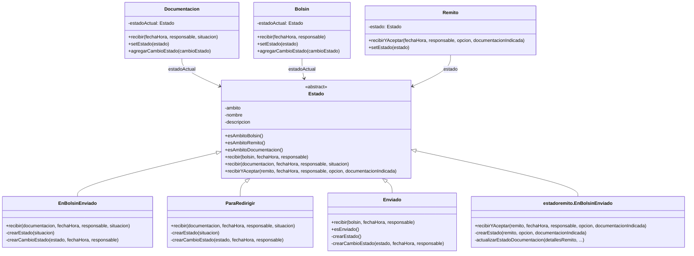

(En el diagrama sólo figuran los estados concretos que redefinen el evento del CU 28.)

### Dinámica en el CU 28

```
GestorRecepcionBolsin.tomarConfirmacion()
 ├─ getFechaYHoraActual()
 ├─ Bolsin.recibir(fechaHora, responsable)
 │   └─ Enviado.recibir(bolsin, ...)                  ← el estado actual del bolsín
 │       *sosActual() sobre los cambios de estado · setFechaHoraFin() · crearEstado(): new RecibidoEnCMDestino
 │       crearCambioEstado(): new CambioEstadoBolsin · bolsin.setEstado() · bolsin.agregarCambioEstado()
 └─ Bolsin.recibirYAceptarRemito(fechaHora, responsable, opción, documentación indicada)
     └─ Remito.recibirYAceptar(...)                    (loop remitos)
         └─ EnBolsinEnviado.recibirYAceptar(remito, ...) ← el estado del remito
             crearEstado(): new RemitoRecibidoYAceptado (o RecibidoYAceptadoParcial si con
                            la opción 2 o 3 se marcó documentación de este remito)
             remito.setEstado()
             actualizarEstadoDocumentacion(detalles)
              └─ DetalleRemito.recibirYAceptarDoc(...)    (loop detalles)
                  └─ Documentacion.recibir(fechaHora, responsable, situación)
                      └─ EnBolsinEnviado.recibir(documentacion, ...)  ← o ParaRedirigir
                          *sosActual() sobre los cambios de estado · setFechaHoraFin()
                          crearEstado(situación): según la guarda, RecibidaYAceptada, NoRecibida,
                                                  RecibidaYRechazada o ParaRedirigir
                          crearCambioEstado() · documentacion.setEstado() · agregarCambioEstado()
```

### Cambios respecto del análisis

- Se eliminaron del gestor `buscarEstadoRecibidoEnCMDestino()`, `buscarEstadoRecibidoYAceptado()`
  y `buscarEstadoRecibidaYAceptada()`, con sus loops sobre `Estado` (`esAmbito...()`,
  `esRecibido...()`). El gestor ya no busca el estado siguiente: lo decide el estado actual de
  cada objeto. La entidad `Estado` ya no existe.
- `CambioEstadoBolsin` y `CambioEstadoDocumentacion` referencian al objeto estado del patrón.
- Una documentación en `ParaRedirigir` también se recibe correctamente, sin agregar ningún
  `if` sobre el estado.
- Si un objeto está en un estado que no admite la transición, el objeto estado la rechaza y la
  transacción se deshace, en lugar de dejar datos inconsistentes.

### Correcciones de la Entrega 1

- **Clase `Usuario`:** `Sesion` conoce al `Usuario` logueado y cada `Empleado` conoce su
  `Usuario`. El gestor hace `sesion.getUsuario()` y busca el empleado con
  `*esTuUsuario(usuario)`, como en el diagrama de secuencia.
- **Llamada al CU incluido:** `llamarCU29()` le pasa el control al gestor del CU 29
  (`GestorNotificacionCU29.notificarRecepcion(...)`), con el correo de la CM origen y la
  situación de cada remito y documento.

### Cómo mostrar el patrón en la defensa

El patrón no se "ve" en la pantalla: es una decisión de diseño interno, y se refleja en el
comportamiento y en el código.

1. **Comportamiento:** el bolsín 101 trae documentación en dos estados distintos
   (`En bolsín enviado` y `Para redirigir`). Con la opción 1, el sistema le pide a cada una
   `recibir()` sin preguntar en qué estado está, y las dos quedan `Recibida y aceptada`, cada
   una resuelta por su propio objeto estado. Si en cambio se marca la 1003 como "no llegó", su
   estado (`Para redirigir`) no tiene esa transición: la rechaza y no se guarda nada.
2. **Código:** `Documentacion.recibir()`, `Bolsin.recibir()` y `Remito.recibirYAceptar()`
   sólo delegan en el estado. En todo el sistema no hay ningún `if` o `switch` que pregunte
   en qué estado está un objeto: los únicos `switch` están dentro de los estados concretos y
   evalúan la **guarda** de la transición, como en la máquina de estados.
3. **Pruebas:** `EstadoDocumentacionTest` y `EstadoBolsinYRemitoTest` disparan los eventos
   desde cada estado: los que tienen la transición pasan al estado que indica la máquina de
   estados, y los demás la rechazan sin cambiar el historial.

## 8. Diseño de la interfaz de usuario

Patrones y criterios de diseño de GUI aplicados en `PantallaGraficaRecepcionBolsin`:

- **Menú de tareas como punto de entrada:** la opción "Registrar recepción de bolsín" es el
  `opcRegistrarRecBolsin()` del caso de uso.
- **Maestro-detalle con filtro:** a la izquierda, los bolsines por recibir y un filtro por
  precinto o CM origen (no distingue mayúsculas ni tildes: "cordoba" encuentra "CM Córdoba");
  al hacer clic en uno, a la derecha aparecen sus remitos, con su estado, y sus documentos.
- **Las cuatro opciones de la ERS a la vista**, con una indicación de qué hacer en cada una.
  Con las opciones 2 a 4 se habilita una columna para **marcar la documentación**, cuyo
  título cambia según la opción ("No llegó", "No corresponde", "Redirigir").
- **Prevención de errores:** las opciones y el botón sólo se habilitan con un bolsín
  seleccionado; si se elige la opción 2, 3 o 4 sin marcar documentación, el sistema lo avisa.
- **Confirmación con resumen** antes de modificar datos: qué bolsín, qué opción y qué
  documentación se marcó. "Volver" no pierde lo marcado.
- **Retroalimentación en el contexto:** un aviso arriba informa el resultado y el estado de
  cada remito; la columna Estado se actualiza. Al terminar, la lista se refresca (el bolsín
  recibido desaparece) y se puede seguir con el próximo sin volver al menú.
- **Estados legibles y codificados por color:** "En bolsín enviado" (celeste), "Para
  redirigir" (naranja), "Recibida y aceptada" (verde), "No recibida" y "Recibida y
  rechazada" (rojo).
- **Estado vacío explícito:** cuando no quedan bolsines, la lista lo indica.
- **Visibilidad del contexto:** siempre se ven el usuario logueado y la CM.

El diseño de experiencia de usuario (mapas de empatía, journey, modo board) lo aporta el
grupo a partir de las actividades de descubrimiento hechas en el aula.

## 9. Pruebas

`mvn test` ejecuta 51 pruebas:

- `EstadoDocumentacionTest`: el evento `recibir()` desde cada estado de la documentación y
  con cada guarda, según la máquina de estados de la Entrega 1.
- `EstadoBolsinYRemitoTest`: los eventos del CU 28 desde cada estado del bolsín y del remito,
  y la búsqueda por precinto y CM origen.
- `RegistrarRecepcionBolsinTest`: el CU 28 de punta a punta por consola, con datos en
  memoria: las cuatro opciones, el filtro (A1 y A2), la opción 4 fuera de la CMC, A6 y la
  cancelación.
- `RepositorioJPATest`: guarda en SQLite, vuelve a abrir la base y verifica los estados; que
  al cancelar o ante una transición inválida no se guarda nada; y que una base de una versión
  anterior se vuelve a crear.
- `NotificacionCorreoTest`: envía los correos a un servidor SMTP de prueba (GreenMail) y
  verifica destinatario (la CM origen), asunto y contenido; también la redirección para la
  demo, el servidor caído y el modo sin configuración.

## 10. Alcance

- Se implementa el **CU 28** y el **envío del correo** del CU 29, que incluye. Los casos de
  uso que siguen después (por ejemplo, el CU 31 para la documentación no recibida o
  rechazada) no se implementan.
- En las tres clases se programan sólo los eventos del CU 28; los de otros casos de uso
  (cerrar, enviar, dar de baja, etc.) quedan en las máquinas de estado.
- Los datos de prueba se cargan como los dejaron los casos de uso anteriores: cada bolsín
  pasó por *Creado* (CU 19), *Cerrado* (CU 39) y *Enviado* (CU 27), y sus remitos y su
  documentación están *En bolsín enviado*.

## 11. Envío de correo (CU 29)

Al registrar la recepción, `llamarCU29()` le pasa al gestor del CU 29 el correo de la CM
origen y los datos de la recepción (`DatosRecepcion`: bolsín, precinto, CM origen y destino,
fecha y hora, quién registró, la opción de recepción y cada remito con su estado y su
documentación). El gestor del CU 29:

1. **arma el correo**, con asunto y cuerpo en texto plano y en HTML (tabla con cada remito y
   la situación de su documentación, como pide la Observación 2 del CU 28);
2. **lo envía** con el `ServicioCorreo` configurado, **en segundo plano**, para que la ventana no
   se congele mientras se conecta con el servidor;
3. **informa el resultado** en el aviso de la pantalla: primero "Enviando…" y después "se envió
   a …" o el motivo del error.

- **Destinatario:** la **CM origen** del bolsín, como dice la ERS ("Notificar por email a la
  comisión médica origen"). `buscarCorreoCM()` le pide el correo al bolsín, que se lo pide a
  su CM origen. En el diagrama de secuencia de la Entrega 1 se le pedía `getEmail()` al
  empleado logueado: ese mensaje cambia.
- **Configuración:** archivo `correo.properties` en la carpeta del proyecto. Hay una plantilla
  en [`correo.properties.ejemplo`](correo.properties.ejemplo), y los pasos para Gmail y Mailtrap
  están en [COMO_EJECUTAR.md](COMO_EJECUTAR.md#paso-3b--configurar-el-envío-de-correo). Ese
  archivo **no se sube al repositorio** porque tiene la contraseña.
- **Demo:** las CM de prueba tienen correos ficticios (dominios `.example`, reservados).
  Con `correo.redirigirA` todos los correos llegan a la casilla que se indique, y el correo
  aclara a quién iba dirigido.
- **Sin configuración**, o si el archivo está incompleto, el programa funciona igual: el correo
  se guarda como HTML en la carpeta `correos-simulados` y el aviso lo indica.
- **Si el envío falla**, la recepción ya quedó guardada: el aviso informa el motivo
  (contraseña rechazada, servidor inaccesible, puerto bloqueado).

**Estructura:** el gestor del CU 29 depende de la interfaz propia `ServicioCorreo`. Solo
`ServicioCorreoSmtp` conoce la API de Jakarta Mail (`Session`, `MimeMessage`, `Transport`), así
que cambiar de proveedor o de librería no toca el gestor. Esa estructura, una interfaz que
espera el sistema más una clase que traduce a la API externa, es la del patrón **Adapter**. Se
puede mencionar si lo preguntan, pero el patrón acordado con la cátedra es State.

